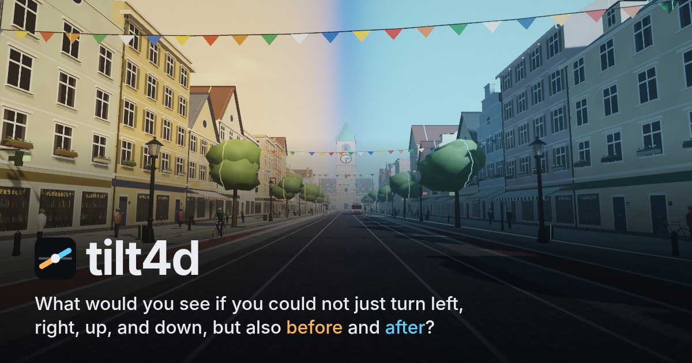

# tilt4d

*What would you see if you could not just turn left, right, up, and down, but
also before and after?*

[](https://wuille.net/tilt4d)

See it [live](https://wuille.net/tilt4d).

A browser demo of rendering as a projection from **four** dimensions to two.
The world is one fixed 4D scene (space plus scene time), and what is on screen
is a 3D slice of it. Besides turning and looking up and down, the camera has
one more rotation: *tilting*, which swings the view out of space and into
time, so that to your right lies the future and to your left the past (or the
other way round, tilted the other way). The
further you tilt, the slower your own time passes: at 90° it stands still, and
beyond that it runs backwards. You move about with ordinary controls, but
within the slice you see. It looks a little like relativity but is not: the
rotation is Euclidean and light is instantaneous.

[CONCEPT.md](CONCEPT.md) is the note the project started from. There the
player always moves at a fixed speed at right angles to the view, so that
tilting and speeding up are the same thing. The demo keeps the tilt and what
it does to time, but no longer ties it to the player's speed, and it tilts the
view from side to side where the note tilts it along the line of sight; see
"How it works" below.

The source is at <https://github.com/sipa/tilt4d>, under the MIT license (see
[License](#license) at the end). The project is very LLM-assisted.

## Running it

```
node tools/serve.mjs        # or: npm start
```

then open <http://localhost:8080/> in a browser with WebGPU (current Chrome or
Edge, Safari 26, Firefox 141 or later; on Linux it may need enabling in the
browser's flags). There is no build step and nothing to install: the page is
plain ES modules. Any static file server works, but the page has to come from
`http://localhost` or `https`, not from a `file:` URL (the single-file build
below can be opened from disk).

To use it from another machine, listen on more than localhost and serve HTTPS:

```
node tools/serve.mjs --host 0.0.0.0 --https     # optionally --port 8443
```

The HTTPS part matters: browsers only provide WebGPU to pages loaded over
https or from localhost, so plain http to another machine's address shows the
menu but cannot start. `--https` makes a self-signed certificate (kept in
`~/.cache/tilt4d`), which the browser asks you to accept once; pass
`--cert` and `--key` to use a real one. The alternative is to leave the server
on localhost and forward the port: `ssh -L 8080:localhost:8080 <host>`.

Pick a scene from the menu. `Esc` brings the menu back. The scenes are listed
from the lightest to draw to the heaviest, each with a mark of one to six
bars for how much there is to draw; the first, the Time Lab, is what runs
behind the menu when the page opens. A bar across the top of the page shows
how far the loading of a scene has got.

### As a single file

```
make
```

or, without make,

```
npm install                 # once: fetches esbuild for the tool
node tools/bundle.mjs       # or: npm run bundle
```

writes `dist/index.html`: the page with its stylesheet and all its scripts,
every scene included, minified into one file of about 800 kB (290 kB as a web
server sends it compressed). The shaders are minified too: they are the
template strings marked `/* wgsl */` in the scripts, and an unmarked one is
left as it is (the tool points out any it finds). It needs nothing beside it, so it can be uploaded
to any web host under any name (over https, as above), passed on to someone,
or opened straight from disk. It takes the same address parameters as the page
itself. `make` fetches the tool the first time and afterwards rebuilds the
file only when something it is made from has changed; `make clean` removes it
and `make OUT=public/index.html` writes it elsewhere. With the tool itself,
`--out` names the file and `--no-minify` leaves the code readable.
`node tools/shot.mjs --page dist/index.html --scene lab` renders from it,
which is a way to check a build.

One thing is worth putting next to it on a web server all the same:
`preview.jpg`, the picture that a link to the page shows where it is posted
(in a chat, on social media), together with the title and the description in
the head of `index.html`. `make` puts a copy of it beside the file, so that
`dist/` (or wherever `OUT` points) holds all there is to upload; the tool by
itself writes only the file. Such previews want full addresses, so the page
names the one of its public copy, <https://wuille.net/tilt4d/>: for a copy
that lives elsewhere, change `og:url` and `og:image` there. The page's icon
needs no file: it is drawn in the page's head.

## Controls

The one control that other games do not have is the **tilt**, and it is the
same everywhere: roll the **mouse wheel** forward, or hold `X`, and what lies
to your right turns to the future and what lies to your left to the past,
further the further off it is; roll it back, or hold `Z`, and it is the other
way round. It works standing still. The tilt stops for a moment when the view
is level again and at 90°, where the view runs straight along time from left
to right. `R` makes the view level and brings you to rest at once.

Turning with the mouse leaves the tilt as it is and only changes where you
look within it: turn to the right in a view tilted with the wheel forward, and
you face the future.

That way the future can be put to either side, ahead or behind, but not above
or below. For that there is a second tilt, **up and down**: hold `V` (or
`Ctrl`, or the right mouse button) while rolling the wheel or holding `Z` or
`X`. Rolled forward, what lies above you turns to the future and what lies
below to the past; rolled back, the other way round. The two tilts add up, and
`R` takes both out. On a trackpad a pinch does the same. (`Ctrl` is the usual
key for such a thing, but with `W` it is the browser's own key for closing the
tab, which a page cannot prevent: `V` and the right mouse button are the safe
ones while walking.)

The tilt also sets the pace of your own time, which the HUD shows: standing
still it passes at the cosine of the tilt, so normally when level, at half
speed at 60°, not at all at 90° and backwards beyond. That holds on foot, in a
car and in the water. In flight there is nothing to hold you, and time passes
at its normal rate whatever the tilt.

Moving is done the usual way. Every scene starts in the control mode that
suits it; `M` switches.

| mode | controls |
|---|---|
| **Walk** | `W A S D` walk, `Shift` run, `Space` jump, mouse to look. You stay upright on a slope, and going up it slows you: hardly on a gentle hill, a good deal on a steep one, and ground steeper than 60° cannot be walked up at all. |
| **Drive** | `W` / `S` speed up / slow down (`S` from rest reverses), `A` / `D` or the mouse steer, `Space` brake, `Shift` for more power. Left alone the car rolls out: slowly below a speed that depends on the scene (30 m/s on the Coastal Circuit; the menu's list of controls names it), quickly above it. Hills slow it, and ground steeper than 45° it cannot climb. |
| **Fly** | mouse to turn, `W A S D` and `Space` / `C` to thrust, `Q` / `E` roll, `Shift` for more thrust, `B` to brake. No drag. |
| **Swim** | as Fly, but the water brings you back to rest. `Shift` sprints. |

You move where the view shows. In a tilted view "to the right" is partly a
direction in time, so stepping or thrusting sideways takes you on in time (or
back) on top of that. So does going forward once you have turned towards the
side that shows the future or the past, which is how a car gets there: steered
towards the future's side, it heads into the future. The readouts show it:

* **speed in slice** is how fast you are moving within the view, which is the
  speed at which the scenery passes;
* **through space** and **through time** are its two parts: the speed over the
  ground, and the seconds of scene time you cross each second by moving
  (negative towards the past);
* **time flows** is the pace of your own time all told: what the tilt leaves of
  it, plus that part through time;
* **to the right** and **looking at** say how much later or earlier the view
  shows things, for every 10 m further to your right and further along your
  line of sight; **upwards**, which is only there while the view is tilted up
  or down, says the same for every 10 m higher up. (In a scene of small, slow
  things these are per 10 cm, and the speeds in cm/s.)

### Settings

The **Settings** button at the top of the menu opens a small panel:

| setting | choices | key while playing |
|---|---|---|
| Mode | the control modes the scene offers | `M` |
| Time colouring | off, slight, full (see below) | `T` |
| Music | off, soft, full (see below) | `N` |
| Units | m/s, km/h or mph, for the readouts and for the speeds the menu names (cm/s, or in/s with mph, in a scene where things move that slowly) | |
| Readouts | shown or hidden | `H` |
| Pace | everything at ⅛ to 8 times its speed | `[` `]` |
| Field of view | 50° to 90° (`?fov=70` in the address sets any) | |
| Look speed | how far the mouse, or a dragging finger, turns the view | |
| Look up / down | normal or inverted | |
| Resolution | automatic (lowered when frames are slow), or full, ¾ or ½ | |

All but the mode and the pace are kept in the browser's storage and are there
again on the next visit; "Back to the defaults" undoes them.

In every mode: `P` freezes you in place so you can look around the slice you
are in (and tilt it), `[` and `]` run everything in slow motion or fast
forward, `Backspace` returns to the start, `H` hides the HUD, `F` toggles full
screen.

The tilt turns more slowly the closer it is to 90° (or 270°), because that is
where the view changes fastest: a held key takes about 5 s for the first 75°,
7 s for the next 10° and 10 s for the last 5°, and a notch of the wheel
shrinks from 5.7° to 0.2°. Adding `?ease=0.04` to the address makes that
slowing milder (`1` turns it off, the default is `0.01`).

Whatever stands still is solid: walls, posts, trees, rocks. You slide along it,
and the part of your speed that went into it is gone. Arches and lanes are as
open as they look. What moves (trams, cars, people walking, fish) is not solid,
and neither are things that come and go, such as blinking lights.

On foot you can jump about 1.3 m high: over a fence at a run, or onto a low
wall or a bench, where you can stand and walk on until you step off the edge.
A jump stops under a ceiling.

The view is always coloured a little by time: what lies in your past has a
slight warm cast and what lies in your future a cool one, stronger the more
time lies between: far from the present it goes as the cube root of that time,
so that it shows on things a second away and keeps growing up to half a
minute. Where a tilted view passes through the present, the warm side goes
over into the cool one gradually, over the same width of the picture for the
ground at your feet as for the sky: about the middle third of the view at a
tilt of 30°, and less of it the steeper the tilt. (A level view is not
changed: everything in it is now.)
`T` goes round three settings: this slight colouring, the full one (amber and
blue outright, with a contour line for every whole second, which makes the
tilt of the slice directly visible), and none. The full one goes by the same
rule, but gets to its full strength within eight seconds, and the passage
between its two sides is a third as wide. Adding `?cast=2` to the address
makes the slight colouring twice as strong.

Every scene has **music** of its own, and the music belongs to the scene's
time: it plays at the pace at which time passes for you. Tilt the view and it
slows and sinks in pitch, at 90° it falls silent, beyond that it plays
backwards, and when you come back to a moment you were at before, the piece is
at the same bar again. (In the Time Lab it ticks once for every second on the
clocks.) Nothing is downloaded for it: each piece is made up for its scene and
synthesised in the browser when the scene loads, which takes a second or two
and some 15 to 30 MB of memory while the scene is open. `N` goes round soft,
off and full.

### Checking performance

The frame rate in the corner of the HUD is tied to the display: 60 fps only
says that the renderer keeps up, not by how much. To see the room there is:

* Press `G`. It draws the view you are looking at a number of times back to
  back, without waiting for the screen, and shows the time per frame and how
  many times the displayed rate that would allow, at the current resolution.
  The browser console gets the same numbers in more detail, including the
  page's own share of the time. Try it at a steep tilt and in the busiest
  spots, since it measures just that one view. Times below a millisecond or so
  are rough.
* To watch an uncapped frame rate all the time, start Chrome with
  `--disable-frame-rate-limit --disable-gpu-vsync`; the HUD's counter then
  shows what the machine can do. (In Firefox, set `layout.frame_rate` to 0 in
  `about:config`.)
* `node tools/cost.mjs <scene>` counts instead of timing: the triangles,
  tetrahedra and draw calls that a frame hands to the graphics card in a set
  of standard views, and a score made of them. It needs no graphics card, and
  it is how the scenes are ranked in the menu and how a change to a scene is
  held to a budget (see the head of that file).
* `?cull=0` in the address makes every pass draw everything, which shows what
  leaving out the unseen saves (compare with `G`). `?order=0` draws static
  geometry in the order it is stored instead of nearest first, which shows
  what the depth test saves when the near things are drawn before the far.
* `?scale=2` in the address renders at twice the resolution in each direction,
  which shows how much of the cost is per pixel. It also switches off the
  automatic lowering of the resolution that otherwise sets in when frames are
  slow.

### On a phone or tablet

Touching the screen brings up on-screen controls instead: a stick under the
left thumb (it appears wherever the thumb lands on the left side), dragging
with the right thumb to look, and a few buttons. In every mode `−` and `+` at
the lower right tilt the view while held (`+` as the wheel rolled forward does:
the future to your right). The small button beside them, `↔`, changes which way
they tilt: tap it and it reads `↕`, and `+` puts the future above you.

| mode | left stick | further buttons |
|---|---|---|
| **Walk** | walk; pushed all the way, run | `jump` |
| **Drive** | up and down speed up and slow down, left and right steer (as does dragging the view sideways) | `brake` |
| **Fly** | thrust | `▲` `▼` thrust up and down, `brake`; twist two fingers to roll |
| **Swim** | swim; pushed all the way, sprint | `▲` `▼` rise and sink |

The row along the top has `level` (level the view and stop), `time` (colour by
time), the control mode (tap to change), full screen and `☰` for the menu. Entering a scene asks the
browser for full screen and landscape where it allows that.

The gauge in the corner is a small spacetime diagram of the view from side to
side: up is later, right is further to your right. The coloured line is what
the view shows across its width, blue on the side where it rises into the
future and amber where it dips into the past. The arrow is your own motion:
straight up while you stand still and time simply passes (shorter the slower
it passes, and pointing down when it runs backwards), leaning over as you move
sideways.

## What to try

* Stand still with a level view: everything looks ordinary, and the scene's
  clocks run.
* Still standing, tilt the view (wheel forward) and watch the clocks on either
  side: those to your right show a later time than your own and those to your
  left an earlier one, more so the further off to the side they are, and all
  of them run slower. Straight ahead they show your own time. Turn to the
  right, and the future lies ahead of you: each clock further away shows a
  later time.
* Tilt further. Things stretch from side to side, and the sky to your left and
  the sky to your right are hours apart.
* At 90° the view runs straight along time and nothing moves any more: what is
  on screen is the history of the one line you are looking along, laid out
  from left to right like a ruler, earlier on the left and later on the right.
  Beyond 90° the world is mirrored and runs backwards; at 180° it is level
  again, in reverse.
* Now step to the left in that tilted view. You head into the past that lies
  on that side, so your own time slows further: fast enough, and it stands
  still before the tilt gets to 90° ("time flows" reaches zero when the part
  of your speed "through time" makes up for what the tilt has left). Step to
  the right and it speeds up again. Or turn to face the past, and walk on.
* Do the same flying. There the tilt leaves the pace of time alone, and only
  your motion changes it.
* Watch something that moves in a regular rhythm, such as a chain of flashing
  lights, and see the rhythm change with the tilt: things that move across your
  view bunch up or stretch out, and at the right tilt a running light is
  everywhere at once.

## How it works

The player is a point in `(x, y, z, t)` with a velocity and an orthonormal 4D
frame: screen right `R`, screen up `U`, facing `F` and a fourth vector `O`,
all measured with time scaled to length: every scene fixes how many metres
stand for one second (10 in the Time Lab, 30 on the Coastal Circuit), which is
how much time its tilt takes in. What is
drawn is the 3D slice spanned by `R`, `U` and `F`; `O` is its normal and is
only there to rotate against. Turning rotates `F` and `R` in their plane,
looking up rotates `F` and `U`, and tilting rotates `R` and `O` in exactly the
same way; the tilt up and down rotates `U` and `O`. (On foot and in a car the
frame has to stay upright to walk and steer by, so there that last rotation is
kept apart from it and applied to the slice at the end.) See `src/player.js`.

The velocity is not part of the frame, and has two parts.

Left alone, the player stays put while scene time passes at `cos θ` seconds
per second: the time component of `O`. One way to read that is that the player
is always carried along `O` at a fixed speed, as in CONCEPT.md, and that whatever
stands still in the world (the ground, the water) holds back the spatial part
of that motion, so that only its time part gets through. Technically it is
friction: the ground brings the player's time rate to `cos θ` at once, water
does it with the same sluggishness as it stops a swimmer. In flight there is
nothing to hold on to, and there the rate is simply 1. (The full rule of
CONCEPT.md would have a tilted flyer drift off through space as well. That
tied what you saw to how fast you went and capped the speed, and it has been
dropped.)

On top of that the controls add an ordinary velocity: a walking speed, a car's
speed along its heading, thrust that accumulates. They do so along the frame's
own vectors, though, and in a tilted frame `R` has a time component (and `F`
gets its share of it when the view is turned): stepping to the left at speed
`v` with tilt θ covers `v·cos θ` metres of ground a second, and the rest of
it, `v·sin θ`, is motion into the past: metres of time, which
the scene's scale turns into seconds. Those are the readouts' speed in slice,
through space and through time. So on the ground time then passes at `cos θ`
less that last part, and stands still when the two are equal; to the right it
is that much more. There is no top
speed, and no speed at which anything special happens.

The car alone has a mark, for the feel of driving and for no deeper reason:
the scene's scale read as a speed (30 m to the second on the circuit, so
30 m/s). Its friction is small up to there (a quarter of the engine holds that
speed) and grows quickly beyond, so that the engine's all is twice the mark,
or 2.8 times with `Shift`. The speed meant is the car's own along `F`, its
speed in the slice.

A walker stands upright whatever the ground does, and keeps their pace along
a slope, so that on the map the part of their motion that goes straight up or
down it shrinks by the slope's cosine. Going up it shrinks further, by
`1 − (slope / 60°)²`: at 15° about a tenth is lost, at 45° more than two
thirds, and ground of 60° or more is like a wall, which can be walked along or
down but not up, by any zigzag or by jumping at it.

A car leans with the ground, and a hill holds it back in the same way with a
limit of 45°: flat out it does 93% of its speed up a slope of 10°, three
quarters up 20°, a third up 30°, and from 45° nothing. A slope that takes
most of the car's motion also wears down the speed the car itself has, so
that one brought to rest by a hillside does not shoot off when it is turned
away.

What the tilt does to the view goes as `tan θ` (things are stretched by
`1 / cos θ`), which runs off to infinity at 90°. So a held tilt key turns at a
rate multiplied by `ease + (1 − ease)·cos² θ`, with `ease` = 0.01: `tan θ`
grows steadily up to about 84°, and the last five degrees go by at 0.7° falling
to 0.4° a second. A notch of the wheel is 0.1 rad times `0.04 + 0.96·cos² θ`.

The slice is drawn like this:

* **Static geometry** is its mesh extruded along the time axis. Each vertex's
  world line meets the slice exactly once, so it is drawn as ordinary triangles
  with a vertex shader that solves for that moment.
* **Moving geometry** is sampled at key times; each triangle sweeps out a prism
  between keys, split into three tetrahedra in `(x, y, z, t)`. A vertex shader
  cuts every tetrahedron with the slice (a 4D version of marching tetrahedra)
  and emits the resulting triangle or quad. Only the chunks of tetrahedra whose
  4D bounding box the slice passes through are sent to the GPU: each frame
  the page writes out a table of them, and a pass draws all of its share in
  one call, its instances looked up in that table. The
  tetrahedra are not stored: a mesh that only moves is kept once, with the
  matrix that places it at each key, and the vertex shader works out the
  corners of each tetrahedron from that. A mesh with a movement of its own
  that repeats on the way (a stride, a wing beat) is kept as the few poses of
  one round of it: the page works out which steps from pose to pose the slice
  can touch, and the shader which two poses a corner lies between. So what
  such a movement costs to keep does not grow with how long it goes on.
* Lighting, sky and materials are evaluated at each pixel's own moment, which
  is why clocks, lamps and the sky all show the tilt.
* Shadows use shadow maps of the slice itself, two or three of them covering
  ever larger areas round the player; terrain can also cast its shadow from a
  baked horizon map, which works at any distance and for any moment. The image
  is rendered in HDR with multisampling, bloom and tone mapping.
* Glossy surfaces mirror the sky or, in scenes that ask for it, a picture of
  the whole scene around the player, redrawn one side per frame.
* A mesh placed many times over (a forest) is stored once and drawn instanced.
  Meshes can have holes cut per pixel (foliage), with matching shadows, or be
  see-through (smoke, glass), and a scene can hand its shader tables of
  numbers as textures.
* Each pass draws only what it can see. Static geometry is sorted into cells
  of neighbouring triangles when a scene is built, and a cell is left out of
  the picture if it lies outside the view, out of a shadow map if nothing in
  it can cast a shadow there, and out of a side of the reflection picture that
  faces away from it. The picture's cells are drawn nearest first, so that
  what they hide is not shaded. The tilt shears static geometry, but by a linear map, so
  the view is still a pyramid in space. For the shadow maps the renderer has
  to know where the light is, which only the scene's shader can say: it reads
  that back from the GPU for a stretch of time round the player's own.
* Small parts of things (door handles, faces, wheel spokes) are given by the
  scenes as detail that is drawn only from near by, so they cost nothing
  across the rest of the scene.

The music is in `src/music.js`: a small synthesiser on an offline Web Audio
context, which each scene's score (the `music` of its definition) is written against, and
a player that keeps the piece on the scene's time. A piece is kept as samples
twice, forwards and backwards, and whichever fits the direction of time is
played at the speed of its pace, steered so that it stays on the moment the
player is at.

`src/renderer.js` and `src/wgsl.js` hold the renderer, `src/builder.js` turns
scene descriptions into those two kinds of geometry. A scene is built in a
worker (`src/build-worker.js`), so the page stays alive while it loads and can
show how far the loading has got; where a worker cannot be had, it is built in
the page itself.

Collisions (`src/collide.js`) use the static triangles themselves, so nothing
is authored twice. The player is an upright cylinder on the ground and a sphere
in free movement, moved in steps shorter than its radius so that no surface can
be stepped across. Running into a surface takes away the part of the velocity
that points into it, and the player slides along with the rest. On the ground
that is done within the slice, with the surface's normal as it appears there,
so that someone walking into a wall in a tilted view stops there instead of
carrying on through time. In free flight the surface's own normal is used,
which has no time component: thrust against a wall in a tilted view and the
part of it that points into time is all that is left.

## Scenes

In the menu's order, from the lightest to draw to the heaviest:

| scene | mode | at 45°, a second per | what shows the tilt |
|---|---|---|---|
| **Time Lab** | walk | 10 m | a bare runway of clocks, plus pendulums, traffic and things that pop in and out of existence |
| **Orbital Station** | fly | 200 m | a ring station turning every 30 s, lanes of beacons whose pulses run at 200 m/s, convoys, clocks on the gateway frames |
| **Coastal Circuit** | drive | 30 m | timing boards every 50 m down a 1.2 km straight, traffic at 15, 30 and 45 m/s, trains, light pulses along the wall |
| **Old Town** | walk | 10 m | a clock tower that follows the sky, street lamps coming on in a wave at dusk, trams, cyclists and walkers on a 200 m avenue |
| **Coral Reef** | swim | 4 m | columns of bubbles all rising at the same pace, vents puffing together, lanes of fish, caustics |
| **Winter Valley** | walk | 12 m | a detailed scene, for desktop GPUs: a ridge's shadow and the alpenglow sweeping over the mountains, lanterns that come on in a wave at dusk with a pulse running up the path, a chairlift, an aerial tram, skaters, skiers, walkers, chimney smoke and clocks that follow the sky |
| **Pleasure Pier** | walk | 5 m | the most intricate scene, for desktop GPUs: a Victorian pier at dusk on a day of ten minutes, where everything runs in cycles. Pier trains at 9 m/s that stretch along the whole track at a tilt of 29°, a big wheel and a swing ride that wind into spirals, firework shells that become cones, lighthouse beams, lamps coming on in a wave out along the pier, chasing bulbs, a tide every three minutes, clocks, and walkers, cyclists, cars and boats at speeds from 1 to 17 m/s |
| **Clockmaker's Workshop** | walk | 30 cm | one small room, for desktop GPUs, where nothing is far away and everything is slow: some 350 moving parts made of about 200,000 small triangles, so that a tilted close-up stays smooth. Wheel trains that mesh, escapements that tick, a wave of pendulums and its shadow, a row of metronomes, an orrery, two steam engines, a music box that plays the scene's tune, a shelf railway, candles, a fire, a cat. Tilted, pendulums bend into S-shapes and wheels twist like screws; fly up close (`M`) and tilt again |

Scenes live in `src/scenes/` and are listed in `src/scenes/index.js`.
[docs/SCENES.md](docs/SCENES.md) explains how to write one;
`src/scenes/lab.js` is a commented example, and `src/scenes/enginetest.js`
(not in the menu: open it with `?scene=enginetest`) shows the engine's newer
features side by side. The seven larger scenes were each written by a separate
Claude Opus agent against that guide, and later given their close-up detail
(faces, wheels, lettering, door handles) the same way. Winter Valley and the
Pleasure Pier are the heavy ones, with about a million static triangles each
and costlier shaders, where the others stay within what a phone can draw. The
Clockmaker's Workshop is as heavy to draw as those two, but the other way
round: a third of their static triangles, and most of its cost in what moves.

`tools/check-solids.mjs <scene>` builds a scene without a browser and checks
its collisions: that the spawn point is clear and that roaming about never
crosses a solid surface.

`tools/shot.mjs` renders a single frame of a scene headlessly, at any position,
time and tilt, which is handy while authoring:

```
npm install                 # once: fetches playwright-core for the tool
node tools/shot.mjs --scene lab --tilt 30 --t 100 --hud --out shot.png
```

It needs a Chromium that Playwright can find (`npx playwright install chromium`).
`--browser firefox` renders in Firefox instead (run it under `xvfb-run -a`),
and `node tools/check-wgsl.mjs` validates every scene's shader with naga, the
WGSL compiler Firefox uses.

With `--card` it lays the page's mark, name and tagline over the picture. That
is how `preview.jpg` was made:

```
node tools/shot.mjs --scene plaza --tilt 38 --pitch 5 --tint 2 --size 1200x630 --card --out preview.jpg
```

## License

tilt4d is open source under the MIT license: see [LICENSE](LICENSE).
Copyright (c) 2026 Pieter Wuille.

The source repository is <https://github.com/sipa/tilt4d>.

The project is very LLM-assisted: most of its code, its scenes, its music and
this documentation were written by Claude, to the author's concept and under
his direction.
